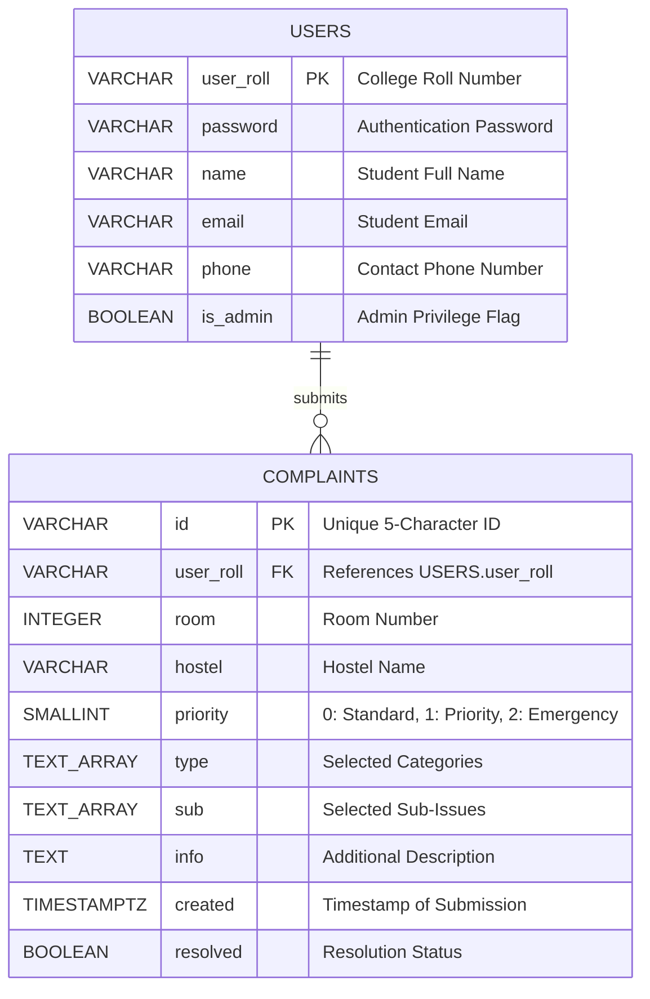

# UniHostel Complaint Portal 🏢

A centralized, cloud-backed hostel grievance redressal and maintenance management system built with **Node.js**, **Vanilla JavaScript**, and **PostgreSQL (Supabase)**.

---

## 🚀 Quick Setup & Installation

Follow these steps to set up and run the UniHostel Complaint Portal locally.

### 1. Prerequisites
Ensure you have the following installed on your machine:
* **Node.js** (v18.0.0 or higher recommended)
* **npm** (Node Package Manager)
* A modern web browser (Chrome, Firefox, Edge, Safari)

---

### 2. Clone or Open the Repository
Open a terminal in the project directory:
```bash
cd attFol
```

---

### 3. Install Dependencies
Install the required packages (`@supabase/supabase-js`):
```bash
npm install
```

---

### 4. Configure Environment Variables
Create or verify the `.env.local` file in the root directory:
```env
NEXT_PUBLIC_SUPABASE_URL=https://your-project.supabase.co
NEXT_PUBLIC_SUPABASE_PUBLISHABLE_KEY=your-supabase-publishable-key
```

> **Note**: For local development, these environment variables connect your server directly to your Supabase PostgreSQL instance.

---

### 5. Database Setup (Supabase PostgreSQL)
If setting up a fresh database, run the following SQL statements in your **Supabase SQL Editor**:

```sql
-- Create users table
CREATE TABLE users (
    user_roll VARCHAR(30) PRIMARY KEY,
    password VARCHAR(255) NOT NULL,
    name VARCHAR(100) NOT NULL,
    email VARCHAR(120) UNIQUE NOT NULL,
    phone VARCHAR(20) NOT NULL,
    is_admin BOOLEAN DEFAULT FALSE
);

-- Create complaints table
CREATE TABLE complaints (
    id VARCHAR(10) PRIMARY KEY,
    user_roll VARCHAR(30) NOT NULL,
    room INTEGER NOT NULL CHECK (room > 0 AND room < 1000),
    hostel VARCHAR(50) NOT NULL,
    priority SMALLINT NOT NULL CHECK (priority IN (0, 1, 2)),
    info TEXT DEFAULT '',
    type TEXT[] NOT NULL DEFAULT '{}',
    sub TEXT[] NOT NULL DEFAULT '{}',
    created TIMESTAMPTZ NOT NULL DEFAULT NOW(),
    resolved BOOLEAN NOT NULL DEFAULT FALSE,
    CONSTRAINT fk_complaints_user 
        FOREIGN KEY (user_roll) 
        REFERENCES users(user_roll) 
        ON DELETE CASCADE 
        ON UPDATE CASCADE
);

-- Optimization indexes
CREATE INDEX idx_complaints_user_roll ON complaints(user_roll);
CREATE INDEX idx_complaints_priority_created ON complaints(priority DESC, created DESC);
CREATE INDEX idx_complaints_resolved ON complaints(resolved);

-- Insert sample users
INSERT INTO users (user_roll, password, name, phone, email, is_admin) VALUES
('BT.24.MCB.C.079', 'pass123', 'Maria Don', '8555979908', 'bt.24.mcb.c.079@avu.students.edu', FALSE),
('SC.22.MCE.A.003', 'pass123', 'Amarilla Dillo', '8555526262', 'sc.22.mce.a.003@avu.students.edu', FALSE),
('SC.25.CSE.B.001', 'admin', 'John Jarok', '8555139785', 'sc.25.cse.b.001@avu.students.edu', TRUE);
```

---

### 6. Start the Server
Start the local server using npm:
```bash
npm run dev
```
*(Or alternatively: `node server.js`)*

The server will launch at:
👉 **`http://localhost:3000`**

---

### 7. Demo Accounts & Credentials

You can test both student and administrator workflows using the pre-seeded credentials:

| Role | College ID (`user_roll`) | Password | Permissions & Available Views |
| :--- | :--- | :--- | :--- |
| **Student** | `BT.24.MCB.C.079` | `pass123` | File complaints, view personal complaint history (`/mylist`). |
| **Admin** | `SC.25.CSE.B.001` | `admin` | Full portal access + **Admin Panel** (`/admin`) for incident triage and resolution. |

---

## 📖 Project Overview

### Problem Statement
In university residential hostels, maintenance and infrastructure grievances (plumbing leaks, electrical faults, broken furniture, structural damage) are traditionally recorded using physical paper registers or verbal reports. This leads to:
* Unaccounted and delayed repair work.
* Lack of urgency or prioritization for dangerous hazards (e.g. electrical sparking vs. cosmetic paint peel).
* Zero status visibility for students.
* No centralized administrative oversight across hostel blocks.

### The Solution: UniHostel Complaint Portal
The **UniHostel Complaint Portal** digitizes the entire grievance lifecycle into a centralized, transparent platform. Students can select their hostel, file categorized complaints with specific sub-issues, and track repair status. Administrators receive a consolidated dashboard sorting issues by severity, with direct student contact info and one-click issue resolution.

---

## 🌟 Key Features

### 👤 Role-Based Authentication & Navigation
* **Institutional Roll Authentication**: Students and administrators sign in using their university roll number and password.
* **Role-Aware Header**: Administrators dynamically receive an **Admin Panel** button and topbar link, while non-admins only see student options.
* **Route Protection**: Direct unauthorized navigation to `/admin` redirects non-admins back to the home page.

### 🏛️ Interactive Campus Hostel Dashboard (`/`)
* 3D card layout featuring 8 residential hostels:
  * **Flavus**, **Daphne**, **Hecate**, **Lares**, **Oreads**, **Medea**, **Istra**, and **Creon**.
* Personalized user greeting and floating action dock.

### 📝 Taxonomical Complaint Registration (`/complaint`)
* **3 Severity Tiers**: *Standard (0)*, *Priority (1)*, *Emergency (2)*.
* **10 Incident Categories**: Water, Electrical Appliance, Wiring, Paint, Furniture/Itinerary, Doors/Windows, Bathroom, Structural, Bed/Mattress, Other.
* **Dynamic Sub-Issue Selectors**: Selecting a category dynamically generates relevant sub-issue cards with custom SVG icons (supporting dozens of specific issues).
* **Additional Notes**: Free-form text area for access notes and damage descriptions.
* **Ticket Receipt (`/done`)**: Generates an alphanumeric complaint receipt (e.g. `#VNZZE`) and posts asynchronously to the database.

### 📋 Student Complaint Tracking (`/mylist`)
* View all personal complaints submitted by the authenticated user.
* Color-coded status badges: `Pending`, `In Progress`, `Resolved`.
* Color-coded priority badges: `Standard`, `Priority`, `Emergency`.
* **"Show More (+X)" Button**: Intelligently collapses long arrays of sub-issues and notes into a clean badge, with an instant toggle to expand all details inline.

### 🛡️ Administrative Console (`/admin`)
* **Clean Header**: Features only the centered UniHostel logo and portal title, with a quick back button returning home.
* **Joined Student Information**: Automatically joins the `users` and `complaints` tables by `user_roll` to display student **Name**, **Roll Number**, **Phone** (with `tel:` link), and **Email** (with `mailto:` link).
* **Multi-Tier Severity Sorting**:
  * Unresolved queue sorted primarily by **Severity** (`Emergency` > `Priority` > `Standard`), and secondarily by **Published Time** (newest first).
* **Partitioned Switch Tabs**:
  * **Unresolved Complaints**: Default view showing active issues with a live count badge.
  * **Resolved Complaints**: Switch view showing all closed issues sorted purely by publication date.
* **One-Click Resolution (`✓ Resolve`)**:
  * Clicking resolve updates the PostgreSQL database (`resolved = true`).
  * Immediately removes the ticket from the Unresolved queue and transfers it to the Resolved queue.
  * Displays a confirmation toast notification.

---

## 🛠️ Technology Stack

| Layer | Technologies Used | Description |
| :--- | :--- | :--- |
| **Frontend** | HTML5, CSS3, JavaScript (ES6+) | Vanilla client architecture; custom design system with `Staatliches` and `Chivo` Google Fonts, CSS Grid, Flexbox, glassmorphism, and responsive layouts. |
| **Client Storage** | Web Storage API (`localStorage`, `sessionStorage`) | Client-side session and role caching with strict boolean normalization. |
| **Backend** | Node.js (`http`, `fs`, `path`, `dns`) | Lightweight native HTTP server with JSON REST API routes and IPv4 DNS optimization. |
| **Database** | PostgreSQL via Supabase | Hosted relational database with ACID compliance, `TEXT[]` array columns, foreign keys, and indexes. |
| **SDK** | `@supabase/supabase-js` | Supabase JavaScript client for asynchronous database queries and mutations. |

---

## 🗄️ Database Schema & Architecture

### Entity-Relationship Diagram (ERD)



### Relational Schema
* **`users`** (`user_roll` [PK], `password`, `name`, `email`, `phone`, `is_admin`)
* **`complaints`** (`id` [PK], `user_roll` [FK], `room`, `hostel`, `priority`, `type`, `sub`, `info`, `created`, `resolved`)

---

## 🔌 API Reference

| Method | Endpoint | Description | Request Body | Response |
| :--- | :--- | :--- | :--- | :--- |
| `POST` | `/api/login` | Authenticate user & retrieve profile | `{"userid": "...", "password": "..."}` | `{"success": true, "user": {...}}` |
| `POST` | `/api/complaint` | Register a new complaint ticket | `{"user_roll": "...", "room": 301, "hostel": "...", "priorityNum": 1, ...}` | `{"success": true, "data": [...]}` |
| `POST` | `/api/get` | Retrieve complaints for logged-in student | `{"user_roll": "..."}` | `{"success": true, "complaints": [...]}` |
| `GET` | `/api/admin` | Retrieve all complaints joined with user data | *None* | `{"success": true, "complaints": [...]}` |
| `POST` | `/api/admin` | Resolve or update a complaint status | `{"action": "resolve", "id": "VNZZE", "resolved": true}` | `{"success": true, "complaint": {...}}` |

---

## 📁 Project Structure

```
attFol/
├── app/
│   └── api/
│       ├── admin/
│       │   └── route.js          # Admin GET (all joined) & POST (resolve) handler
│       ├── complaint/
│       │   └── route.js          # Complaint submission handler
│       ├── get/
│       │   └── route.js          # Student personal complaints handler
│       └── login/
│           └── route.js          # User verification & role-assignment handler
├── assets/
│   ├── complaints/               # Category & sub-issue SVG icons
│   │   └── sub/                  # 35+ contextual issue icons
│   ├── hostels/                  # Campus hostel heraldry images
│   ├── 404bg.png                 # Error page background
│   └── logo.png                  # UniHostel brand logo
├── css/
│   ├── admin.css                 # Admin portal, switch tabs, & table styles
│   ├── complaint.css             # Complaint entry & sub-issue selector styles
│   ├── done.css                  # Ticket receipt card styles
│   ├── login.css                 # Login box & input styles
│   ├── mylist.css                # Student complaints table & overflow styles
│   ├── styles.css                # Main dashboard & hostel 3D grid styles
│   └── topbar.css                # Shared header, navbar & theme variables
├── html/
│   ├── 404.html                  # Not found page
│   ├── about.html                # About Us portal
│   ├── admin.html                # Admin console (no topbar, switch tabs)
│   ├── complaint.html            # Complaint registration form
│   ├── contact.html              # Emergency contact directory
│   ├── done.html                 # Confirmation receipt screen
│   ├── index.html                # Main hostel selection dashboard
│   ├── info.html                 # FAQ & guidelines
│   ├── login.html                # Authentication screen
│   └── mylist.html               # Personal complaints tracking screen
├── js/
│   ├── admin.js                  # Admin table logic, sorting, tabs & resolve triggers
│   ├── complaint.js              # Complaint form, categories, & sub-issue toggling
│   ├── done.js                   # Confirmation ticket generation
│   ├── login.js                  # Login authentication & Web Storage caching
│   ├── mylist.js                 # Student ledger & overflow "Show More" logic
│   └── script.js                 # Dashboard interactions & role-based Admin button
├── .env.local                    # Supabase API keys & URL
├── package.json                  # Node dependencies & npm scripts
├── PROJECT_REPORT.md             # Full academic DBMS project report
├── README.md                     # Project documentation & setup guide
└── server.js                     # Main Node.js HTTP server & static file router
```

---

## 📝 Academic Context
* **Course**: 23CSE202 Database Management Systems
* **Department**: Department of Computer Science and Engineering
* **Institution**: Amrita School of Computing, Amrita Vishwa Vidyapeetham, Amritapuri Campus
* For the complete academic submission report, refer to [PROJECT_REPORT.md](PROJECT_REPORT.md).

---

## 📄 License
This project is developed for educational and institutional demonstration purposes. All rights reserved.
