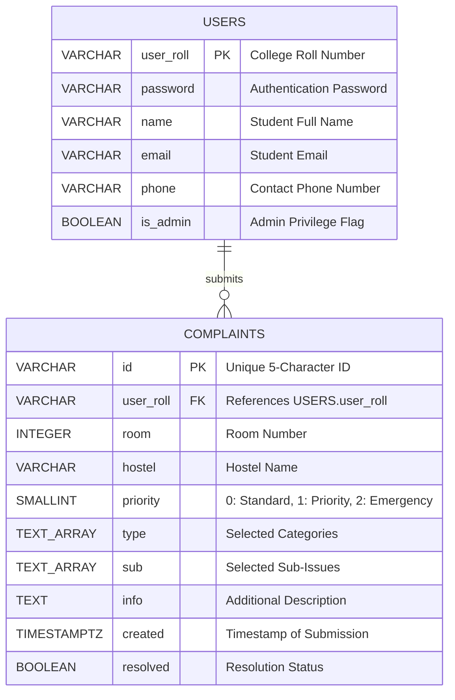

# UniHostel Complaint Portal

A centralized, cloud-backed hostel grievance redressal and maintenance management system built with **Node.js**, **Vanilla JavaScript**, and **PostgreSQL (Supabase)**.

---

## Quick Setup & Installation

Follow these steps to set up and run the UniHostel Complaint Portal locally.

### 1. Prerequisites
Ensure you have the following installed on your machine:
* **Node.js** (v18.0.0 or higher recommended)
* **npm** (Node Package Manager)
* A modern web browser (Chrome, Firefox, Edge, Safari)

---

### 2. Clone or Open the Repository
Open a terminal in the project directory:
```bash
cd attFol
```

---

### 3. Install Dependencies
Install the required packages (`@supabase/supabase-js`):
```bash
npm install
```

---

### 4. Configure Environment Variables
Create or verify the `.env.local` file in the root directory:
```env
NEXT_PUBLIC_SUPABASE_URL=https://your-project.supabase.co
NEXT_PUBLIC_SUPABASE_PUBLISHABLE_KEY=your-supabase-publishable-key
```

> **Note**: For local development, these environment variables connect your server directly to your Supabase PostgreSQL instance.

---

### 5. Database Setup (Supabase PostgreSQL)

In the database, the complaint `id` is a 5-character uppercase alphanumeric string (e.g., `0FP6V`, `1UT28`, `482Y4`, `6Q2PJ`, `7LRL8`, `CX5I9`). To automatically generate unique random IDs on insert without requiring the client or backend to pass an ID manually, run the following SQL statements in your **Supabase SQL Editor**:

```sql
-- 1. Create a function to generate a random 5-character alphanumeric ID (0-9, A-Z)
CREATE OR REPLACE FUNCTION generate_complaint_id() 
RETURNS TEXT AS $$
DECLARE
    chars TEXT := '0123456789ABCDEFGHIJKLMNOPQRSTUVWXYZ';
    result TEXT := '';
    i INT;
BEGIN
    FOR i IN 1..5 LOOP
        result := result || substr(chars, floor(random() * length(chars) + 1)::INT, 1);
    END LOOP;
    RETURN result;
END;
$$ LANGUAGE plpgsql;

-- 2. Create users table
CREATE TABLE users (
    user_roll VARCHAR(30) PRIMARY KEY,
    password VARCHAR(255) NOT NULL,
    name VARCHAR(100) NOT NULL,
    email VARCHAR(120) UNIQUE NOT NULL,
    phone VARCHAR(20) NOT NULL,
    is_admin BOOLEAN DEFAULT FALSE
);

-- 3. Create complaints table with auto-generated random ID as DEFAULT
CREATE TABLE complaints (
    id VARCHAR(10) PRIMARY KEY DEFAULT generate_complaint_id(),
    user_roll VARCHAR(30) NOT NULL,
    room INTEGER NOT NULL CHECK (room > 0 AND room < 1000),
    hostel VARCHAR(50) NOT NULL,
    priority SMALLINT NOT NULL CHECK (priority IN (0, 1, 2)),
    info TEXT DEFAULT '',
    type TEXT[] NOT NULL DEFAULT '{}',
    sub TEXT[] NOT NULL DEFAULT '{}',
    created TIMESTAMPTZ NOT NULL DEFAULT NOW(),
    resolved BOOLEAN NOT NULL DEFAULT FALSE,
    CONSTRAINT fk_complaints_user 
        FOREIGN KEY (user_roll) 
        REFERENCES users(user_roll) 
        ON DELETE CASCADE 
        ON UPDATE CASCADE
);

-- 4. Create performance indexes
CREATE INDEX idx_complaints_user_roll ON complaints(user_roll);
CREATE INDEX idx_complaints_priority_created ON complaints(priority DESC, created DESC);
CREATE INDEX idx_complaints_resolved ON complaints(resolved);

-- 5. Insert sample users (Students & Administrator)
INSERT INTO users (user_roll, password, name, phone, email, is_admin) VALUES
('BT.24.MCB.C.079', 'pass123', 'Maria Don', '8555979908', 'bt.24.mcb.c.079@avu.students.edu', FALSE),
('SC.22.MCE.A.003', 'pass123', 'Amarilla Dillo', '8555526262', 'sc.22.mce.a.003@avu.students.edu', FALSE),
('SC.25.CSE.B.001', 'admin', 'John Jarok', '8555139785', 'sc.25.cse.b.001@avu.students.edu', TRUE);
```

#### How the ID is Auto-Generated Randomly
* When an insert query is executed (such as from `app/api/complaint/route.js`), the `id` field is **omitted** from the insert payload.
* PostgreSQL automatically invokes `DEFAULT generate_complaint_id()`, pulling 5 pseudo-random characters from `'0123456789ABCDEFGHIJKLMNOPQRSTUVWXYZ'`.
* This generates clean, human-readable ticket codes (such as `0FP6V`, `1UT28`, `482Y4`, `6Q2PJ`, `7LRL8`, `CX5I9`) while guaranteeing primary key uniqueness.

```sql
-- Example insert query demonstrating auto-generation:
-- Notice 'id' is not specified; PostgreSQL assigns it automatically via the function.
INSERT INTO complaints (user_roll, room, hostel, priority, info, type, sub, created)
VALUES (
    'BT.24.MCB.C.079', 
    334, 
    'Flavus Hostel', 
    2, 
    'No water supply in floor bathrooms', 
    ARRAY['Water Issue'], 
    ARRAY['No Water Supply'], 
    NOW()
)
RETURNING id, user_roll, room, hostel, created;
```

---

### 6. Start the Server
Start the local server using npm:
```bash
npm run dev
```
*(Or alternatively: `node server.js`)*

The server will launch at:
**`http://localhost:3000`**

---

### 7. Demo Accounts & Credentials

You can test both student and administrator workflows using the pre-seeded credentials:

| Role | College ID (`user_roll`) | Password | Permissions & Available Views |
| :--- | :--- | :--- | :--- |
| **Student** | `BT.24.MCB.C.079` | `pass123` | File complaints, view personal complaint history (`/mylist`). |
| **Admin** | `SC.25.CSE.B.001` | `admin` | Full portal access + **Admin Panel** (`/admin`) for incident triage and resolution. |

---

## How Every Backend Interacts with the Database

The backend architecture consists of a Node.js server (`server.js`) that routes API requests to dedicated handler modules under `app/api/`. Each module interacts with PostgreSQL via the `@supabase/supabase-js` client library.

### Client Connection Initialization
Each backend route uses a singleton connection pattern via `getSupabaseClient()`:
```javascript
const { createClient } = require('@supabase/supabase-js');

let supabase = null;
function getSupabaseClient() {
    if (!supabase) {
        const supabaseUrl = process.env.NEXT_PUBLIC_SUPABASE_URL;
        const supabaseKey = process.env.NEXT_PUBLIC_SUPABASE_PUBLISHABLE_KEY;
        if (supabaseUrl && supabaseKey) {
            supabase = createClient(supabaseUrl, supabaseKey);
        }
    }
    return supabase;
}
```
In `server.js`, DNS resolution is configured using `dns.setDefaultResultOrder('ipv4first')` to optimize connection pooling and prevent handshake timeouts on environments with dormant IPv6 routes.

---

### 1. User Authentication (`app/api/login/route.js`)
* **Endpoint**: `POST /api/login`
* **Purpose**: Authenticate user credentials and check administrative privileges.
* **Incoming Payload**:
  ```json
  {
    "userid": "SC.25.CSE.B.001",
    "password": "admin"
  }
  ```
* **Database Interaction**:
  The handler executes a parameterized query against the `users` table:
  ```javascript
  const { data, error } = await client
    .from("users")
    .select("user_roll, password, name, email, phone, is_admin")
    .eq("user_roll", userid)
    .eq("password", password)
    .single();
  ```
* **Operation & Response**:
  * Validates that both `userid` and `password` match an existing row.
  * If invalid or not found, responds with HTTP 401 (`Invalid User ID or password`).
  * If valid, normalizes `is_admin` to a strict boolean (`const isAdmin = Boolean(data.is_admin);`) and returns the profile payload:
    ```json
    {
      "success": true,
      "user": {
        "userid": "SC.25.CSE.B.001",
        "user_roll": "SC.25.CSE.B.001",
        "name": "John Jarok",
        "email": "sc.25.cse.b.001@avu.students.edu",
        "phone": "8555139785",
        "is_admin": true
      }
    }
    ```

---

### 2. Complaint Registration (`app/api/complaint/route.js`)
* **Endpoint**: `POST /api/complaint`
* **Purpose**: Record a new complaint ticket into the database.
* **Incoming Payload**:
  ```json
  {
    "user_roll": "BT.24.MCB.C.079",
    "room": 334,
    "hostel": "Flavus Hostel",
    "priorityNum": 2,
    "info": "Water leaking from ceiling pipe",
    "type": ["Water Issue", "Structural Issue"],
    "sub": ["Leaking Tap/Pipe", "Ceiling Seepage"],
    "timestamp": "2026-10-11T15:33:00.341Z"
  }
  ```
* **Database Interaction**:
  1. Formats `type` and `sub` into proper arrays for PostgreSQL `TEXT[]` compatibility:
     ```javascript
     const typeArr = Array.isArray(type) ? type : (type ? type.split(',').map(s => s.trim()) : []);
     const subArr = Array.isArray(sub) ? sub : (sub ? sub.split(',').map(s => s.trim()) : []);
     ```
  2. Inserts the record into the `complaints` table, intentionally omitting `id`:
     ```javascript
     const { data, error } = await client
       .from("complaints")
       .insert([{ 
         user_roll, 
         room, 
         hostel, 
         priority: Number(priorityNum), 
         info: info || '', 
         type: typeArr,
         sub: subArr,
         created: timestamp
       }])
       .select();
     ```
* **Operation & Response**:
  * PostgreSQL triggers the column default `generate_complaint_id()`, generating a unique random 5-character ID (such as `0FP6V` or `1UT28`).
  * `.select()` immediately returns the committed row including the generated `id`, returning HTTP 200 to the client.

---

### 3. Student Personal Complaints Retrieval (`app/api/get/route.js`)
* **Endpoint**: `POST /api/get`
* **Purpose**: Fetch all complaints filed by the currently authenticated student for display in `/mylist`.
* **Incoming Payload**:
  ```json
  {
    "user_roll": "BT.24.MCB.C.079"
  }
  ```
* **Database Interaction**:
  The handler queries `complaints` filtered by `user_roll`:
  ```javascript
  const { data, error } = await client
    .from("complaints")
    .select("id, room, hostel, type, sub, priority, info, created, resolved")
    .eq("user_roll", user_roll)
    .order("created", { ascending: false });
  ```
* **Operation & Response**:
  * Scans the `idx_complaints_user_roll` index to return all complaints filed by that student.
  * Orders rows by timestamp in descending order (`created DESC`).
  * Returns `{ success: true, complaints: data || [] }`, enabling students to monitor the status (`Pending` vs `Resolved`) and details of their tickets.

---

### 4. Administrative Complaints Overview & Resolution (`app/api/admin/route.js`)
This route handles administrative oversight, joining data across tables and updating resolution state.

#### A. Fetching All Complaints with Student Contact Data (GET /api/admin)
* **Purpose**: Display all university complaints on the admin console, enriched with student details.
* **Database Interaction**:
  The handler executes parallel queries across both tables:
  ```javascript
  const [complaintsRes, usersRes] = await Promise.all([
    client.from("complaints").select("*"),
    client.from("users").select("user_roll, name, email, phone")
  ]);
  ```
* **Relational Joining in Backend**:
  Builds a lookup hash map of users by `user_roll` and joins the two data sets:
  ```javascript
  const userMap = {};
  usersRes.data.forEach(u => {
    userMap[u.user_roll] = u;
  });

  const complaints = complaintsRes.data.map(item => {
    const u = userMap[item.user_roll] || {};
    return {
      ...item,
      name: u.name || 'Unknown',
      email: u.email || '-',
      phone: u.phone || '-'
    };
  });
  ```
* **Result**:
  Every complaint is decorated with student contact info (`name`, `email`, `phone`), eliminating the need for administrators to consult separate student record directories.

#### B. Resolving a Complaint (POST /api/admin)
* **Purpose**: Mark an issue as resolved in the database upon administrative confirmation.
* **Incoming Payload**:
  ```json
  {
    "action": "resolve",
    "id": "VNZZE",
    "resolved": true
  }
  ```
* **Database Interaction**:
  Executes an update query targeting the complaint by its primary key:
  ```javascript
  const { data, error } = await client
    .from("complaints")
    .update({ resolved: true })
    .eq("id", id)
    .select();
  ```
* **Operation & Response**:
  * Updates the `resolved` boolean column to `true`.
  * Returns HTTP 200 with the updated row.
  * On the frontend, the ticket is dynamically moved from the "Unresolved" queue to the "Resolved" queue and live counter badges update instantly.

---

## Project Overview

### Problem Statement
In university residential hostels, maintenance and infrastructure grievances (plumbing leaks, electrical faults, broken furniture, structural damage) are traditionally recorded using physical paper registers or verbal reports. This leads to:
* Unaccounted and delayed repair work.
* Lack of urgency or prioritization for dangerous hazards (e.g. electrical sparking vs. cosmetic paint peel).
* Zero status visibility for students.
* No centralized administrative oversight across hostel blocks.

### The Solution: UniHostel Complaint Portal
The **UniHostel Complaint Portal** digitizes the entire grievance lifecycle into a centralized, transparent platform. Students can select their hostel, file categorized complaints with specific sub-issues, and track repair status. Administrators receive a consolidated dashboard sorting issues by severity, with direct student contact info and one-click issue resolution.

---

## Key Features

### Role-Based Authentication & Navigation
* **Institutional Roll Authentication**: Students and administrators sign in using their university roll number and password.
* **Role-Aware Header**: Administrators dynamically receive an **Admin Panel** button and topbar link, while non-admins only see student options.
* **Route Protection**: Direct unauthorized navigation to `/admin` redirects non-admins back to the home page.

### Interactive Campus Hostel Dashboard (`/`)
* 3D card layout featuring 8 residential hostels:
  * **Flavus**, **Daphne**, **Hecate**, **Lares**, **Oreads**, **Medea**, **Istra**, and **Creon**.
* Personalized user greeting and floating action dock.

### Taxonomical Complaint Registration (`/complaint`)
* **3 Severity Tiers**: *Standard (0)*, *Priority (1)*, *Emergency (2)*.
* **10 Incident Categories**: Water, Electrical Appliance, Wiring, Paint, Furniture/Itinerary, Doors/Windows, Bathroom, Structural, Bed/Mattress, Other.
* **Dynamic Sub-Issue Selectors**: Selecting a category dynamically generates relevant sub-issue cards with custom SVG icons (supporting dozens of specific issues).
* **Additional Notes**: Free-form text area for access notes and damage descriptions.
* **Ticket Receipt (`/done`)**: Generates an alphanumeric complaint receipt (e.g. `#VNZZE`) and posts asynchronously to the database.

### Student Complaint Tracking (`/mylist`)
* View all personal complaints submitted by the authenticated user.
* Color-coded status badges: `Pending`, `In Progress`, `Resolved`.
* Color-coded priority badges: `Standard`, `Priority`, `Emergency`.
* **"Show More (+X)" Button**: Intelligently collapses long arrays of sub-issues and notes into a clean badge, with an instant toggle to expand all details inline.

### Administrative Console (`/admin`)
* **Clean Header**: Features only the centered UniHostel logo and portal title, with a quick back button returning home.
* **Joined Student Information**: Automatically joins the `users` and `complaints` tables by `user_roll` to display student **Name**, **Roll Number**, **Phone** (with `tel:` link), and **Email** (with `mailto:` link).
* **Multi-Tier Severity Sorting**:
  * Unresolved queue sorted primarily by **Severity** (`Emergency` > `Priority` > `Standard`), and secondarily by **Published Time** (newest first).
* **Partitioned Switch Tabs**:
  * **Unresolved Complaints**: Default view showing active issues with a live count badge.
  * **Resolved Complaints**: Switch view showing all closed issues sorted purely by publication date.
* **One-Click Resolution (`Resolve`)**:
  * Clicking resolve updates the PostgreSQL database (`resolved = true`).
  * Immediately removes the ticket from the Unresolved queue and transfers it to the Resolved queue.
  * Displays a confirmation toast notification.

---

## Technology Stack

| Layer | Technologies Used | Description |
| :--- | :--- | :--- |
| **Frontend** | HTML5, CSS3, JavaScript (ES6+) | Vanilla client architecture; custom design system with `Staatliches` and `Chivo` Google Fonts, CSS Grid, Flexbox, glassmorphism, and responsive layouts. |
| **Client Storage** | Web Storage API (`localStorage`, `sessionStorage`) | Client-side session and role caching with strict boolean normalization. |
| **Backend** | Node.js (`http`, `fs`, `path`, `dns`) | Lightweight native HTTP server with JSON REST API routes and IPv4 DNS optimization. |
| **Database** | PostgreSQL via Supabase | Hosted relational database with ACID compliance, `TEXT[]` array columns, foreign keys, and indexes. |
| **SDK** | `@supabase/supabase-js` | Supabase JavaScript client for asynchronous database queries and mutations. |

---

## Database Schema & Architecture

### Entity-Relationship Diagram (ERD)



### Relational Schema
* **`users`** (`user_roll` [PK], `password`, `name`, `email`, `phone`, `is_admin`)
* **`complaints`** (`id` [PK], `user_roll` [FK], `room`, `hostel`, `priority`, `type`, `sub`, `info`, `created`, `resolved`)

---

## Relational Database Theory & Formal Design (2nd Year DBMS Concepts)

This section details the theoretical database management foundations of the UniHostel Complaint Portal, covering relational key classification, functional dependencies, attribute closure algorithms, formal normalization up to BCNF, decomposition guarantees, relational integrity constraints, and ACID transaction mechanics.

### 1. Relational Keys and Classification
For every relation, attributes are classified as either **prime attributes** (members of at least one candidate key) or **non-prime attributes** (not part of any candidate key).

#### Relation: `users`
* Attributes: $U = \{\text{user\_roll}, \text{password}, \text{name}, \text{email}, \text{phone}, \text{is\_admin}\}$
* **Super Keys (SK)**: Any superset containing a candidate key. Examples include:
  * $\{\text{user\_roll}\}$, $\{\text{user\_roll}, \text{name}\}$, $\{\text{email}\}$, $\{\text{email}, \text{phone}\}$, $\{\text{user\_roll}, \text{email}\}$, etc.
* **Candidate Keys (CK)**: Minimal super keys whose proper subsets are not super keys.
  * $CK_1 = \{\text{user\_roll}\}$
  * $CK_2 = \{\text{email}\}$ (enforced by unique constraint)
* **Primary Key (PK)**: Selected minimal identifier: $\underline{\text{user\_roll}}$
* **Alternate Key**: $\text{email}$
* **Prime Attributes**: $\{\text{user\_roll}, \text{email}\}$
* **Non-Prime Attributes**: $\{\text{password}, \text{name}, \text{phone}, \text{is\_admin}\}$

#### Relation: `complaints`
* Attributes: $C = \{\text{id}, \text{user\_roll}, \text{room}, \text{hostel}, \text{priority}, \text{type}, \text{sub}, \text{info}, \text{created}, \text{resolved}\}$
* **Candidate Key (CK)**: Exactly one minimal key:
  * $CK_1 = \{\text{id}\}$
* **Primary Key (PK)**: Selected minimal identifier: $\underline{\text{id}}$
* **Foreign Key (FK)**: $\text{user\_roll}$ referencing $\text{users}(\text{user\_roll})$
* **Prime Attributes**: $\{\text{id}\}$
* **Non-Prime Attributes**: $\{\text{user\_roll}, \text{room}, \text{hostel}, \text{priority}, \text{type}, \text{sub}, \text{info}, \text{created}, \text{resolved}\}$

---

### 2. Functional Dependencies (FDs)
A functional dependency $\alpha \rightarrow \beta$ states that whenever two tuples agree on attribute set $\alpha$, they must also agree on attribute set $\beta$.

#### Full Functional Dependency Set ($F$)
* **For `users`**:
  * $FD_1: \text{user\_roll} \rightarrow \{\text{password}, \text{name}, \text{email}, \text{phone}, \text{is\_admin}\}$
    *(A student's institutional roll number uniquely identifies their name, password, email, contact phone, and administrative role.)*
  * $FD_2: \text{email} \rightarrow \{\text{user\_roll}, \text{password}, \text{name}, \text{phone}, \text{is\_admin}\}$
    *(Because institutional email addresses are strictly unique, email also functionally determines all profile attributes.)*
* **For `complaints`**:
  * $FD_3: \text{id} \rightarrow \{\text{user\_roll}, \text{room}, \text{hostel}, \text{priority}, \text{type}, \text{sub}, \text{info}, \text{created}, \text{resolved}\}$
    *(Every complaint ticket has an auto-generated 5-character primary key that uniquely determines hostel, room, tags, timestamps, and resolution state.)*
* **Non-Dependencies**:
  * $\text{user\_roll} \not\rightarrow \text{id}$ *(A student may lodge multiple complaints over time; thus roll number does not uniquely determine ticket ID.)*
  * $\text{hostel} \not\rightarrow \text{room}$ *(Multiple rooms exist in each hostel block.)*
  * $\text{room} \not\rightarrow \text{hostel}$ *(Room 302 exists across multiple independent hostel blocks.)*

#### Trivial vs. Non-Trivial FDs
* An FD $\alpha \rightarrow \beta$ is **trivial** if $\beta \subseteq \alpha$ (e.g., $\{\text{user\_roll}, \text{name}\} \rightarrow \text{name}$).
* An FD $\alpha \rightarrow \beta$ is **non-trivial** if $\beta \not\subseteq \alpha$ (e.g., $FD_1, FD_2, FD_3$ are strictly non-trivial).
* An FD is **completely non-trivial** if $\alpha \cap \beta = \emptyset$. All application domain FDs in UniHostel are completely non-trivial.

---

### 3. Attribute Closure Algorithm ($X^+$)
The attribute closure $X^+$ with respect to an FD set $F$ is the set of all attributes functionally determined by $X$. It is computed iteratively:

$$\text{Initialize } X^{(0)} = X$$
$$\text{Repeat until convergence: } X^{(i+1)} = X^{(i)} \cup \{\gamma \mid \alpha \rightarrow \beta \in F, \alpha \subseteq X^{(i)}, \gamma \in \beta\}$$

#### Verification of Candidate Keys
1. **Testing $\{\text{user\_roll}\}$ on `users`**:
   * $X^{(0)} = \{\text{user\_roll}\}$
   * Using $FD_1$: $X^{(1)} = \{\text{user\_roll}, \text{password}, \text{name}, \text{email}, \text{phone}, \text{is\_admin}\}$
   * Since $X^{(1)} = U$ (all attributes of `users`), $\{\text{user\_roll}\}$ is a valid Super Key. Because it is a single attribute, no proper subset can be a key; therefore, it is a **minimal Candidate Key**.
2. **Testing $\{\text{email}\}$ on `users`**:
   * $X^{(0)} = \{\text{email}\}$
   * Using $FD_2$: $X^{(1)} = \{\text{email}, \text{user\_roll}, \text{password}, \text{name}, \text{phone}, \text{is\_admin}\}$
   * Since $X^{(1)} = U$, $\{\text{email}\}$ is an alternate **Candidate Key**.
3. **Testing $\{\text{id}\}$ on `complaints`**:
   * $X^{(0)} = \{\text{id}\}$
   * Using $FD_3$: $X^{(1)} = \{\text{id}, \text{user\_roll}, \text{room}, \text{hostel}, \text{priority}, \text{type}, \text{sub}, \text{info}, \text{created}, \text{resolved}\}$
   * Since $X^{(1)} = C$, $\{\text{id}\}$ is a minimal **Candidate Key**.

---

### 4. Normalization Analysis (1NF through BCNF)
Normalization is the systematic process of organizing data to eliminate modification anomalies (Insertion, Deletion, and Update anomalies) and reduce redundant data storage.

```
+--------------------------------------------------------------------+
| Unnormalized Data (Repeating groups, multi-valued attributes)      |
+--------------------------------------------------------------------+
                                  |
                                  v
+--------------------------------------------------------------------+
| 1NF (Atomic domain values, distinct tuple identification)          |
+--------------------------------------------------------------------+
                                  |
                                  v
+--------------------------------------------------------------------+
| 2NF (1NF + No partial dependencies on any candidate key)           |
+--------------------------------------------------------------------+
                                  |
                                  v
+--------------------------------------------------------------------+
| 3NF (2NF + No transitive dependencies: X -> Y requires X=SK or Y=Prime) |
+--------------------------------------------------------------------+
                                  |
                                  v
+--------------------------------------------------------------------+
| BCNF (Strict 3NF: For every non-trivial X -> Y, X must be a Super Key)   |
+--------------------------------------------------------------------+
```

#### First Normal Form (1NF)
* **Definition**: A relation is in 1NF if and only if the domain of each attribute contains only atomic (indivisible) values, and there are no repeating groups.
* **Application Analysis**:
  * In classic relational theory, multivalued attributes (like multiple problem categories or sub-issue tags) violate strict scalar atomicity if stored as comma-delimited strings.
  * In the UniHostel schema, PostgreSQL's native `TEXT[]` collection type provides type-safe, first-class arrays with indexable elements.
  * Each record in `complaints` has a primary key `id` ensuring unique tuple identity. 
  * If classical scalar decomposition is required, multi-valued tags decompose cleanly into child relations $\text{complaint\_categories}(\underline{\text{complaint\_id}, \text{category}})$ and $\text{complaint\_subissues}(\underline{\text{complaint\_id}, \text{sub\_issue}})$.

#### Second Normal Form (2NF)
* **Definition**: A relation is in 2NF if it is in 1NF and **no non-prime attribute is partially dependent on any candidate key**. A partial dependency exists if a proper subset of a composite candidate key determines a non-prime attribute:
  $$\exists X \subset CK \text{ such that } X \rightarrow A \text{ where } A \notin CK$$
* **Proof of 2NF**:
  * For `users`, Candidate Keys are $\{\text{user\_roll}\}$ and $\{\text{email}\}$. Both keys are single attributes (cardinality 1). No proper non-empty subset of a single attribute exists.
  * For `complaints`, the sole Candidate Key is $\{\text{id}\}$. This is also a single-attribute key.
  * **Theorem**: Any relation in 1NF whose candidate keys are all simple (non-composite) is inherently in **Second Normal Form**.
  * Therefore, both `users` and `complaints` strictly satisfy 2NF with zero partial dependencies.

#### Third Normal Form (3NF)
* **Definition**: A relation is in 3NF if it is in 2NF and for every non-trivial functional dependency $X \rightarrow Y$, at least one of the following conditions holds:
  1. $X$ is a **Super Key** of the relation, OR
  2. $Y$ is a **Prime Attribute** (member of some candidate key).
  *(Equivalently: No non-prime attribute is transitively dependent on a candidate key.)*
* **Proof of 3NF**:
  * In `users`:
    * For $FD_1: \text{user\_roll} \rightarrow \{\dots\}$, $X = \{\text{user\_roll}\}$ is a Super Key (Condition 1 holds).
    * For $FD_2: \text{email} \rightarrow \{\dots\}$, $X = \{\text{email}\}$ is a Super Key (Condition 1 holds).
  * In `complaints`:
    * For $FD_3: \text{id} \rightarrow \{\dots\}$, $X = \{\text{id}\}$ is a Super Key (Condition 1 holds).
  * Neither relation contains transitive dependencies (e.g., $CK \rightarrow A$ and $A \rightarrow B$ where $A, B$ are non-prime).
  * Therefore, both relations strictly satisfy **Third Normal Form**.

#### Boyce-Codd Normal Form (BCNF)
* **Definition**: A relation is in BCNF if and only if for every non-trivial functional dependency $X \rightarrow Y$, $X$ is a **Super Key**.
  *(BCNF eliminates all anomalies that 3NF might permit when multiple overlapping candidate keys exist.)*
* **Proof of BCNF**:
  * In `users`, the determinants of all non-trivial FDs are $\{\text{user\_roll}\}$ and $\{\text{email}\}$. Both are candidate keys, and therefore super keys.
  * In `complaints`, the sole determinant of all non-trivial FDs is $\{\text{id}\}$, which is a super key.
  * No non-trivial functional dependency exists where the left-hand side is not a super key.
  * **Conclusion**: The schema is strictly in **Boyce-Codd Normal Form (BCNF)**.

---

### 5. Decomposition Properties

#### Lossless-Join Decomposition (Non-Additive Join)
A decomposition of relation $R$ into $R_1$ and $R_2$ is **lossless** with respect to FD set $F$ if and only if:

$$R_1 \bowtie R_2 = R$$

By relational theory theorem, this holds if and only if:
$$(R_1 \cap R_2) \rightarrow R_1 \quad \text{OR} \quad (R_1 \cap R_2) \rightarrow R_2$$

* **Application Verification**:
  * Let universal grievance state be represented as $R(\text{id}, \text{user\_roll}, \text{name}, \text{email}, \text{phone}, \text{room}, \text{hostel}, \text{priority}, \dots)$.
  * Decomposed into $R_1 = \text{users}$ and $R_2 = \text{complaints}$.
  * The intersection is:
    $$R_1 \cap R_2 = \{\text{user\_roll}\}$$
  * Since $\text{user\_roll} \rightarrow R_1$ holds in $\text{users}$ ($\text{user\_roll}$ is the primary key of `users`), the intersection attribute is a super key of $R_1$.
  * **Conclusion**: The decomposition between `users` and `complaints` is guaranteed to be **strictly lossless**. No spurious tuples can be generated during relational joins (`INNER JOIN users ON complaints.user_roll = users.user_roll`).

#### Dependency Preservation
* A decomposition is dependency-preserving if the union of projected dependencies on individual tables covers all original dependencies:
  $$(F_1 \cup F_2 \cup \dots \cup F_n)^+ = F^+$$
* All dependencies governing users ($FD_1, FD_2$) can be checked solely within the `users` table.
* All dependencies governing complaints ($FD_3$) can be checked solely within the `complaints` table.
* No cross-table functional dependency exists that requires joining relations to verify. Hence, the decomposition is **strictly dependency-preserving**.

---

### 6. Relational Integrity Rules & Constraints
The database enforces all four core relational model constraints:

| Constraint Type | Implementation in Schema | Relational Purpose |
| :--- | :--- | :--- |
| **Domain Constraint** | `room INTEGER CHECK (room > 0 AND room < 1000)`<br>`priority SMALLINT CHECK (priority IN (0, 1, 2))` | Restricts values to legal mathematical domains, preventing negative room numbers or invalid priority ratings. |
| **Entity Integrity** | `users(user_roll PRIMARY KEY)`<br>`complaints(id PRIMARY KEY)` | Mandates that primary key attributes cannot contain `NULL` and must be strictly unique across all rows. |
| **Referential Integrity** | `CONSTRAINT fk_complaints_user FOREIGN KEY (user_roll) REFERENCES users(user_roll) ON DELETE CASCADE ON UPDATE CASCADE` | Forbids orphan complaints. If a student record is updated or removed, referential integrity cascades consistently. |
| **Key / Uniqueness Constraint** | `email VARCHAR(120) UNIQUE NOT NULL` | Guarantees candidate key properties for secondary identifying attributes. |

---

### 7. ACID Transaction Properties
Database interactions in the application adhere to standard ACID properties:

* **Atomicity**: During complaint submission (`POST /api/complaint`), the insert operation and default ID generation succeed or fail as a single indivisible unit. If database connectivity drops mid-operation, no partial records are written.
* **Consistency**: All incoming transactions must satisfy foreign key constraints, priority checks (`0, 1, 2`), and primary key uniqueness before transaction commit. Violations result in transaction rollback and HTTP 400/500 client errors.
* **Isolation**: Concurrent transactions (e.g., multiple students filing complaints simultaneously in Daphne Hostel or administrators resolving tickets) execute in isolation. PostgreSQL uses Multi-Version Concurrency Control (MVCC) to ensure read transactions never block write transactions.
* **Durability**: Once an administrator clicks `Resolve` and the database responds with HTTP 200, the updated `resolved = true` state is committed to PostgreSQL's Write-Ahead Log (WAL) on disk, ensuring durability even across server reboots.

---

---

## API Reference

| Method | Endpoint | Description | Request Body | Response |
| :--- | :--- | :--- | :--- | :--- |
| `POST` | `/api/login` | Authenticate user & retrieve profile | `{"userid": "...", "password": "..."}` | `{"success": true, "user": {...}}` |
| `POST` | `/api/complaint` | Register a new complaint ticket | `{"user_roll": "...", "room": 301, "hostel": "...", "priorityNum": 1, ...}` | `{"success": true, "data": [...]}` |
| `POST` | `/api/get` | Retrieve complaints for logged-in student | `{"user_roll": "..."}` | `{"success": true, "complaints": [...]}` |
| `GET` | `/api/admin` | Retrieve all complaints joined with user data | *None* | `{"success": true, "complaints": [...]}` |
| `POST` | `/api/admin` | Resolve or update a complaint status | `{"action": "resolve", "id": "VNZZE", "resolved": true}` | `{"success": true, "complaint": {...}}` |

---

## Project Structure

```
attFol/
├── app/
│   └── api/
│       ├── admin/
│       │   └── route.js          # Admin GET (all joined) & POST (resolve) handler
│       ├── complaint/
│       │   └── route.js          # Complaint submission handler
│       ├── get/
│       │   └── route.js          # Student personal complaints handler
│       └── login/
│           └── route.js          # User verification & role-assignment handler
├── assets/
│   ├── complaints/               # Category & sub-issue SVG icons
│   │   └── sub/                  # 35+ contextual issue icons
│   ├── hostels/                  # Campus hostel heraldry images
│   ├── 404bg.png                 # Error page background
│   └── logo.png                  # UniHostel brand logo
├── css/
│   ├── admin.css                 # Admin portal, switch tabs, & table styles
│   ├── complaint.css             # Complaint entry & sub-issue selector styles
│   ├── done.css                  # Ticket receipt card styles
│   ├── login.css                 # Login box & input styles
│   ├── mylist.css                # Student complaints table & overflow styles
│   ├── styles.css                # Main dashboard & hostel 3D grid styles
│   └── topbar.css                # Shared header, navbar & theme variables
├── html/
│   ├── 404.html                  # Not found page
│   ├── about.html                # About Us portal
│   ├── admin.html                # Admin console (no topbar, switch tabs)
│   ├── complaint.html            # Complaint registration form
│   ├── contact.html              # Emergency contact directory
│   ├── done.html                 # Confirmation receipt screen
│   ├── index.html                # Main hostel selection dashboard
│   ├── info.html                 # FAQ & guidelines
│   ├── login.html                # Authentication screen
│   └── mylist.html               # Personal complaints tracking screen
├── js/
│   ├── admin.js                  # Admin table logic, sorting, tabs & resolve triggers
│   ├── complaint.js              # Complaint form, categories, & sub-issue toggling
│   ├── done.js                   # Confirmation ticket generation
│   ├── login.js                  # Login authentication & Web Storage caching
│   ├── mylist.js                 # Student ledger & overflow "Show More" logic
│   └── script.js                 # Dashboard interactions & role-based Admin button
├── .env.local                    # Supabase API keys & URL
├── package.json                  # Node dependencies & npm scripts
├── PROJECT_REPORT.md             # Full academic DBMS project report
├── README.md                     # Project documentation & setup guide
└── server.js                     # Main Node.js HTTP server & static file router
```

---

## Academic Context
* **Course**: 23CSE202 Database Management Systems
* **Department**: Department of Computer Science and Engineering
* **Institution**: Amrita School of Computing, Amrita Vishwa Vidyapeetham, Amritapuri Campus
* For the complete academic submission report, refer to [PROJECT_REPORT.md](PROJECT_REPORT.md).

---

## License
This project is developed for educational and institutional demonstration purposes. All rights reserved.
